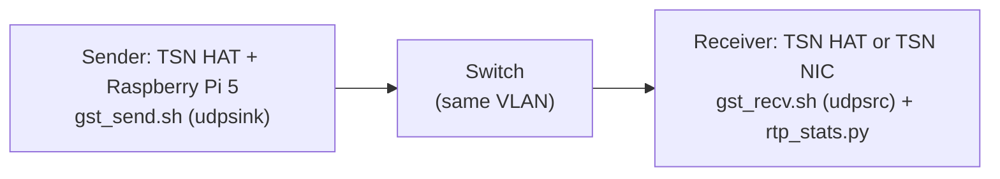

# Sending a GStreamer video stream over TSN

This example sends video (RTP/JPEG) between TSN boards with GStreamer `udpsink` and `udpsrc` pipelines.
The receiver measures loss, arrival jitter and bandwidth. An optional relay adds board gPTP timestamps to measure sender-application to receiver-MAC latency (L1).

| File | Runs on | Purpose |
|---|---|---|
| `gst_send.sh` | sender | GStreamer test video, JPEG/RTP, UDP send |
| `gst_recv.sh` | receiver | GStreamer UDP receive and decode (optional display) |
| `rtp_stats.py` | receiver | Receive quality per RTP stream (loss, reordering, jitter, bandwidth) with hardware receive timestamps; L1 sample collection |
| `rtp_l1_tag.py` | sender | Relay that adds the board gPTP send time to each RTP packet (RFC 8285 header extension) |
| `l1_finalize.py` | any host | Offline judgement of one L1 acquisition from the sender and receiver records |
| `l1_out.py` | (library) | Exclusive reservation and publishing of result files, used by the three L1 tools |

## 1. Setup



- Tested: two TSN HATs (sender and receiver), and one TSN HAT (sender) with one TSN NIC (receiver), on the same switch VLAN.
- The video source is the GStreamer test source (`videotestsrc`). To use a camera, replace the first element of `gst_send.sh` with `v4l2src` or similar.
- If the receiver is a TSN NIC, replace `--iface eth1` below with the interface name of that PC (for example `ens4d1`).

## 2. Installation

On both hosts:

```sh
sudo apt-get update
sudo apt-get install -y gstreamer1.0-tools gstreamer1.0-plugins-base gstreamer1.0-plugins-good python3
cd ~/tsn-sdk/examples/gstreamer
```

`rtp_l1_tag.py` and the L1 mode of `rtp_stats.py` also use `../common/tsnctl.py`, which is included in this repository (see [`../README.md`](../README.md)).

## 3. Running

1. On the receiver, start the receive pipeline and the measurement, each in its own terminal, in this folder. The measurement waits 35 s.

   ```sh
   sh gst_recv.sh 5000                     # to show the video: sh gst_recv.sh 5000 display
   sudo python3 rtp_stats.py --iface eth1 --port 5000 --seconds 35
   ```

2. On the sender, send video for 25 s. Replace `192.0.2.20` with the `eth1` address of the receiver. Start within 10 s after starting the measurement.

   ```sh
   timeout 25 sh gst_send.sh 192.0.2.20 5000                         # color bars, about 16 Mbps
   timeout 25 sh gst_send.sh 192.0.2.20 5000 1280 720 30 85 snow     # noise, about 120 to 150 Mbps
   ```

`gst_send.sh` arguments: `<receiver IP> [port] [width] [height] [fps] [JPEG quality] [pattern]`.

`rtp_stats.py` prints one line per second and a summary JSON at the end.

| Field | Meaning |
|---|---|
| `pkts`, `L2_mbps` | Number of RTP packets received and bandwidth (Ethernet header to FCS). In the summary, bandwidth is divided by the time from the first to the last packet (`active_seconds`) |
| `lost` | Sequence numbers between the first and last received sequence number that never arrived. Counted per RTP source (SSRC) and summed (`streams`). `gap` in the per-second line is the holes seen in that second (removed from `lost` if the packet arrives late) |
| `loss_exact` | true if no sequence number ambiguity was detected. It does not mean the loss count is exact. It is false if the sequence number jumps forward or back by 16,384 or more at once; `lost` is then only indicative. Long outages or losses of a full wrap (65,536 packets) cannot be detected (16-bit sequence number limit). If a long outage is suspected, compare with the total number of packets sent |
| `streams`, `main_ssrc` | Values per source. Restarting the sending GStreamer creates a new source. The top-level `jitter_us` and `max_gap_us` are the values of the source with the most packets (`main_ssrc`) |
| `reordered`, `duplicates` | Packets that arrived late out of order, and sequence numbers received twice (not losses) |
| `capture_drops` | Packets missed by the measurement program. If not 0, part of `lost` is measurement loss |
| `jitter_us` | RFC 3550 interarrival jitter. All packets of one JPEG frame have the same RTP timestamp, so the value reflects the sender's packet bursts more than network delay variation. It varies strongly with the receiving host |
| `max_gap_us` | Longest arrival gap between two consecutive packets (including the gap between video frames) |
| `hw_ts`, `sw_ts`, `ts_source_switches` | Packets timed with the board hardware receive timestamp, packets timed with a software timestamp, and the number of source changes. Across a change, `jitter_us` and `max_gap_us` are not continued |

## 4. Expected results

Reference values measured by TSN Lab (through a 1 GbE switch, 1280x720, 30 fps, JPEG quality 85).
The packet count is proportional to the send time (packets per second x seconds sent).

| Video | Setup | Bandwidth (L2) | Packets per second | Lost / received | jitter |
|---|---|---|---|---|---|
| Color bars | HAT -> HAT (25 s) | 16.2 Mbps | about 1,410 | 0 / 35,250 | 13.6 us |
| Color bars | HAT -> HAT, reverse direction | 16.2 Mbps | about 1,410 | 0 / 35,250 | 13.5 us |
| Noise | HAT -> HAT (25 s) | 148.4 Mbps | about 12,850 | 0 / 320,850 | 11.7 us |
| Color bars | HAT -> NIC | 16.2 Mbps | about 1,240 | 0 / 31,020 | about 14 us |
| Noise | HAT -> NIC | 123.5 Mbps | - | 0 / 192,457 | about 12 us |

- Jitter depends on the receiving host and the run. In other runs on the same two HATs (with an earlier version of the program) jitter was about 47 us for color bars and about 325 us for noise; the cause of the difference was not identified. Check zero loss and `capture_drops` 0 first.
- The noise video bandwidth varied between 120 and 150 Mbps with the same command.
- The HAT -> NIC rows were measured with an earlier version of the program (bandwidth divided by the measurement time).

## 5. Measuring sender-application to receiver-MAC latency (L1)

`jitter_us` from `rtp_stats.py` is arrival jitter, not latency. To measure latency, insert the relay `rtp_l1_tag.py` on the sender and, after the run, compare the records of the same acquisition with `l1_finalize.py`.

- What is measured: **sender application to receiver MAC latency (including sender software, kernel, DMA and queuing)**. It is neither the pure MAC-to-MAC network latency nor the latency until the image is displayed.
- Start point: the sender board gPTP time read over PCIe by the relay for each packet. Extension insertion, counting, `sendto`, kernel, driver, DMA and board transmit queue waiting after that read are included. GStreamer encoding and packetization, loopback delivery and relay processing before the time read are not included.
- End point: the hardware receive timestamp taken by the receiver board. Socket buffer, `udpsrc` and `rtpjitterbuffer` (latency 50 ms) waiting are not included.
- The time is carried in an L1 element of an RTP header extension (RFC 8285 one-byte header). Element = `L1` marker, format version 1, flags, the run number of this relay execution (32 bit), gPTP time in ns (8 bytes). The extension ID (default 1) is a local number chosen for this session and has no standard meaning.
  - Flags must be exactly `0x01` (bit 0 = time source is board gPTP, other bits reserved 0). Otherwise the receiver excludes the packet as `bad_flags`.
  - The run number is a 32-bit random value chosen per execution. It is not an authentication value; two executions choose the same run with probability 2^-32. Therefore the judgement also checks that the element send time lies within the tagging interval of this sender record.
- An RTP packet without an extension grows by 24 bytes (with `mtu=1400` in `gst_send.sh`, the IPv4 packet stays at or below 1,452 bytes). RTP sequence number, timestamp, SSRC and payload are not changed. Existing extension elements are neither removed nor overwritten.
- No extra installation (Python 3 standard library and `../common/tsnctl.py`).

Procedure (collect each acquisition under a new name in a new folder, then judge):

1. Choose an acquisition name (letters, digits, `_.-`, up to 64 characters) and create a folder with that name on both hosts. Keep the files of earlier acquisitions as they are.

   ```sh
   ACQ=L1_run01
   mkdir "$ACQ"
   ```

2. Check that both boards are synchronized by gPTP (`sudo python3 ../common/tsnctl.py sync` reports `"synced": true`).
3. Receiver (this folder, terminals 1 and 2). Start the receive measurement before the sender and give it enough time to end after the sender.

   ```sh
   sh gst_recv.sh 5000
   sudo python3 rtp_stats.py --iface eth1 --port 5000 --seconds 40 --l1-ext-id 1 --acq-id "$ACQ" --json "$ACQ/rx.json"
   ```

4. Sender (this folder, terminals 1 and 2). Start the relay first, then send the video to the loopback port. `192.0.2.20` is the `eth1` address of the receiver.

   ```sh
   sudo python3 rtp_l1_tag.py --iface eth1 --dest 192.0.2.20 --listen-port 5004 --port 5000 --seconds 32 --acq-id "$ACQ" --json "$ACQ/tag.json"
   timeout 25 sh gst_send.sh 127.0.0.1 5004
   ```

5. Check that both programs exit with code 0. Exit code 3 means the attempt is incomplete (`complete` is false in the record, the reason is in `stage` and `error`). If the receiver is stopped with Ctrl+C, it keeps the counts so far, sets `interrupted: true` and exits with 130 (also incomplete). For the sender, Ctrl+C while relaying with `--seconds 0` is a normal end; Ctrl+C in any other stage gives `interrupted: true` and 130, as for the receiver. Do not judge incomplete acquisitions; repeat with a new acquisition name.
   - Errors (including `OSError`) or Ctrl+C during socket cleanup after collection (restoring the hardware timestamp setting, reading counters, closing) are still recorded. If the first cleanup problem is the cause of this acquisition, `stage` is `cleanup`; if another cause already existed, that cause is kept and the problem is appended to `cleanup_errors`. The exit code is decided by the first cleanup problem only: 130 if it is a Ctrl+C, otherwise 3 (even if a Ctrl+C follows). Its class name is stored in `cleanup_first_error_type`, and whether it is a cancellation (`KeyboardInterrupt` or a subclass) in `cleanup_first_error_cancel`. The exit code and `interrupted` follow the cancellation flag, not the class name.
   - If the kernel reports that receive statistics (`PACKET_STATISTICS`) are not supported (`ENOPROTOOPT`, `EOPNOTSUPP`), this is not an error: `capture_drops_status` is `"unsupported:<errno>"` and `capture_drops` is `null`. Other read failures are cleanup errors.
   - Ctrl+C during cleanup and publishing is counted instead of stopping immediately. The count until just before the record JSON is built is `extra_interrupts_during_finish`. If there was no other cause until then, that first Ctrl+C is the cancellation cause of the acquisition (`finish_interrupt_is_cause: true`, incomplete, 130). If a cause already existed, it is only counted, and the first cause and exit code are kept.
   - Ctrl+C received after the record JSON is built (while publishing or releasing the reservation) does not modify the published record. It is reported only as `after_record_interrupts` in the last line of standard output; the exit code follows the record. Ctrl+C after the program has restored the signal handler, execution outside the main thread, SIGKILL and power loss are outside this rule. To stop the program in those cases, terminate the process separately (the record may then be missing; see the leftover reservation procedure below).
   - If the record cannot be written to disk (no space, the result already exists, or the reservation was replaced by another one), no success summary is printed. The last line of standard output is `{"published": false, "error": ..., "unpublished_record": ...}` and the exit code is 3. `unpublished_record` contains the counts of the acquisition; existing results and other reservations are left untouched.
6. Create `gm.json`, a manual record that both boards were synchronized to the same GM and domain (format below). Put the raw evidence (for example a saved switch gPTP status output) in the same folder and record its SHA-256.
7. Put `tag.json`, `rx.json`, `gm.json` and the raw evidence in one folder and run the judgement (no device access):

   ```sh
   python3 l1_finalize.py "$ACQ/rx.json" "$ACQ/tag.json" --gm-evidence "$ACQ/gm.json" --out "$ACQ/l1.json"
   ```

Result files and reservations:

- If the `--json` or `--out` path, or its reservation file `<path>.lock`, already exists, none of the three programs starts. Do not reuse a name.
- At start, each program creates `<path>.lock` exclusively to reserve the path, writes to a per-execution temporary file, and publishes only if the result does not exist yet. A result already published by another execution is never overwritten. At the end (success, handled failure, Ctrl+C) the program removes its own reservation (rules in `l1_out.py`).
  - If creating the reservation fails (error while writing its content, Ctrl+C), the program removes only the file it created and stops.
  - To remove its reservation, the program first renames it to its own release file, checks again that it owns it, and then deletes it. If it belongs to someone else, it is renamed back and not deleted.
  - While a program is running, people and other programs must not delete or change `<path>.lock` (no recovery during execution). Otherwise a replacement between "own reservation confirmed" and "publish" cannot be prevented (existing results are still not overwritten). Atomicity is not guaranteed with file locks (flock or similar).
- If `<path>.lock` remains after a forced termination (power loss, SIGKILL), the next execution refuses that path. Confirm that the earlier execution has ended, delete the `.lock` manually and repeat with a new acquisition name. The programs never delete leftover reservations by themselves.
- The reservation release result is reported as `reservation_release` in the last JSON line of standard output of the receiver and sender (`l1_finalize.py` prints one `{"reservation_release": ...}` line to standard error only if the release failed). If `released` is false, check `code` (for example `rename_failed`, `claim_remove_failed`, `foreign_restore_failed`), `errno` and `leftover` (remaining file paths). The release is attempted once and never retried (calling it again in the same execution leaves the files untouched and keeps the first result). If the release ended with an unhandled exception (`code` is `exception`), check `stage` (the step where it happened), `candidates` (each path that may hold the reservation, with `owner` = `mine`, `foreign` or `unknown` and `exists`) and `owner_certain`. `leftover` lists the candidate paths that exist now. If `owner` is `unknown`, ownership could not be confirmed; do not delete the file before checking its content. The measurement record stays valid and is not modified. After confirming the execution has ended, delete the remaining files manually (only the `.lock` and `.rel` files in `leftover`). If the reservation was replaced by another one (`foreign_*`, `owner` is `foreign`), do not delete it before checking its content. If creating the reservation fails, the program raises the first error unchanged; if cleaning up its own reservation also failed, that fact and the remaining path are appended to the error message.
- If reading the file status (`fstat`) fails right after creating the reservation, an empty `<path>.lock` may remain. The program could not confirm that the file is its own, so it does not delete it and prints the path in the error message.
- If opening the device, preparing the socket, collecting or reading the final status fails, an incomplete record is still written and the exit code is 3. If arguments, paths or the sending device are rejected, no record is written.
- `l1_finalize.py` first checks that both records have the shape written by a program that ran to the end: `complete` is `true` (not a string), no `error`, `stage` is `done`, `interrupted` is `false` (missing in older sender records is treated as false), the counter fields and the `updates` and `resid.count` of the status blocks are non-negative integers (not bool, string or float). The receive time limit `l1_max_us`, whether given with `--l1-max-us` or taken from the receive record, must be a finite positive number (NaN, Infinity, 0, negative or bool gives "not judged"). Without `--l1-max-us`, if the record value is null or missing, the default of 1,000,000 us is used. Any mismatch gives "not judged" with the reason (exit code 3). A result JSON is still written if the top level or `l1` of a record is not an object. This is a format check to filter hand-edited records; the file SHA-256 only records the bytes read and does not authenticate the content.
- If `l1_finalize.py` is stopped with Ctrl+C, it writes no result and exits with 130 (its own reservation is removed).
- When sharing a result, keep `rx.json`, `tag.json`, `gm.json` and the raw evidence together with `l1.json` (`inputs` in `l1.json` lists the SHA-256 of each).

`gm.json` format (`L1-GM-manual-v1`, written by a person after checking):

```json
{"schema": "L1-GM-manual-v1", "acq_id": "L1_run01", "run": "<run from tag.json>",
 "captured_at_utc": "2026-01-01T04:00:30Z", "checked_by": "<person who checked>",
 "source": {"path": "switch_gptp_status.txt", "sha256": "<SHA-256 of the raw evidence>"},
 "sender":   {"board_pci": "<tag.json board.pci>", "iface": "eth1", "gm_identity": "<GM clock identity>", "domain": 0, "profile": "802.1AS", "timescale": "PTP"},
 "receiver": {"board_pci": "<rx.json l1.status_start.pci>", "iface": "eth1", "gm_identity": "<GM clock identity>", "domain": 0, "profile": "802.1AS", "timescale": "PTP"}}
```

- `checked_by`, `acq_id`, `run`, `captured_at_utc`, `source.path` and `sha256`, and `board_pci`, `iface`, `gm_identity`, `profile` and `timescale` of both sides are strings and must not be empty after trimming leading and trailing spaces. `domain` is an integer (not true or false). Comparisons use the trimmed values. Even with a matching SHA-256 of the raw evidence, an empty field gives "not judged". The program does not verify that the content is true.

`l1_judgement` in the `l1_finalize.py` output is `valid_manual_gm` only if all of the following hold. Otherwise it is `not_judged` with `reasons`. Do not use the numbers of a `not_judged` result as latency.

| Check | Content |
|---|---|
| Same acquisition | Both records complete (`complete`), same format, extension ID and `acq_id`; the sender run is present in the receive record; SSRC is among those tagged by the sender; received count per SSRC <= tagging attempts of the sender; receive times within the sender tagging interval; element send times within the sender tagging interval |
| Device mapping | Within each host: sender time board PCI = sender `--iface` PCI = PCI of the start and end status device. Receiver capture `--iface` PCI = PCI of the start and end status device. The PCI addresses of the two hosts need not be equal. If the receiver `--dev` is a different board from `--iface`, the receiver does not start |
| Measurement | At least one valid sample for the run (otherwise `no_samples`) |
| Time base | On both boards, the start and end status blocks show a Slave port, asCapable and residual offset <= 500 ns, and both the status update count and the offset count increased in between. The receiver driver parameter `rx_ts_gptp` is 1. The sender time source is board gPTP |
| GM (manual) | All fields of `gm.json` present; same acquisition (`acq_id`, `run`); capture time within +-600 s (`--gm-max-skew-s`) of the start and end of the sender record; raw evidence SHA-256 matches; same `gm_identity`, `domain`, `profile` and `timescale` on both boards; `board_pci` and `iface` match the boards of the two records |

- `valid_manual_gm` means that this acquisition satisfies the conditions above, conditional on the GM identity recorded manually by a person. The program does not query or verify the GM automatically. The presence of hardware receive timestamps alone is not evidence of synchronization.
- The start and end checks do not rule out loss of synchronization during the measurement.
- The result is a statistic of the observed samples. Acceptance criteria for the whole video flow (minimum sample count, allowed missing ratio, latency threshold) must be defined before the test.
- `denominators` in the result contains: sender counts (`tx_counts`, `send_errors`), tagging attempts per SSRC (counted before `sendto`, not successful sends), receive totals (`rx_totals`: pkts, hw_ts, sw_ts, capture_drops, header_rejects), receive exclusion reasons (`rx_excluded`), counts per SSRC of other runs (`rx_other_runs_pkts`), and per-SSRC denominators of this run (`pkts`, `samples`, `missing_hw_ts`, `abnormal`, `duplicates_skipped`).

`l1.excluded` in `rx.json` (packets excluded from the L1 samples; loss and jitter statistics are unchanged):

| Reason | Meaning |
|---|---|
| `no_ext`, `no_id`, `other_profile` | No time extension (did not pass the relay) or another extension format |
| `foreign_elem` | Element with the same ID but not in L1 format (overlaps with an extension of another meaning) |
| `bad_flags` | L1 flags are not `0x01` |
| `bad_rtp`, `bad_padding`, `bad_ext`, `id15`, `dup_id` | RTP, padding or extension structure error, ID 15 present, the same ID more than once |
| `truncated`, `fragment`, `length_mismatch` | Truncated capture, IP fragment (not supported), IP/UDP length mismatch |

- `header_rejects` (all modes, shown in the summary only if not 0): EtherType is IPv4 but the header is truncated (`truncated_ip_header`), IP version is not 4 (`bad_ip_version`), IHL is less than 5 (`bad_ihl`), the UDP header is truncated (`truncated_udp_header`). Only that frame is skipped and reception continues. These are counted before the port is read, so frames of other flows may be included.
- Duplicate detection: the samples of this run are deduplicated by sequence number per (run, SSRC). Packets of other runs or without extension that use the same sequence number do not remove samples of this run. The general loss and order statistics (`streams`) remain per SSRC.
- If the relay cannot read the gPTP time, it does not send. It never substitutes the host clock.
- `--iface` of the relay selects the board whose time is read. The device actually used for sending is `--egress-dev` (default: `--iface`), and the socket is bound to it. Only `--iface` itself, or an 802.1Q VLAN device whose only lower device is `--iface`, is allowed. Bridges, bonds and other upper devices are rejected. The choice is recorded as `egress` in `tag.json`. The actual OS transmit path (routing, bridge behaviour) has not yet been verified on a board.
- With the relay, the end-to-end video latency gains one loopback hop and the relay processing. The part before the time read is not included in L1; the part after it is.
- Use the same version of the files on the sender and the receiver. `gm.json` files of earlier versions (`sender_gm`, `receiver_gm`) and runs without `--acq-id` are not judged by this version.
- Verified scope: offline tests only (synthetic packets and synthetic times). No L1 values measured on boards are available yet.

## 6. Adding a VLAN priority (PCP)

In a network where the switch separates traffic by VLAN priority, create a VLAN interface with a PCP mapping. Give the VLAN interface a subnet different from `eth1`; with the same subnet, the route may select `eth1` and frames may leave untagged.

Sender:

```sh
sudo ip link add link eth1 name eth1.10 type vlan id 10 egress-qos-map 0:5
sudo ip addr add 198.51.100.10/24 dev eth1.10
sudo ip link set eth1.10 up
timeout 25 sh gst_send.sh 198.51.100.20 5000
```

Receiver (when receiving the frames still tagged):

```sh
sudo ip link add link eth1 name eth1.10 type vlan id 10
sudo ip addr add 198.51.100.20/24 dev eth1.10
sudo ip link set eth1.10 up
sudo python3 rtp_stats.py --iface eth1 --port 5000 --seconds 35
```

- The hardware transmit queue in the board is queue 1 regardless of PCP. This example only adds the VLAN PCP tag.
- Queue classification by PCP is done by an external TSN switch. The switch needs a PCP to traffic class (egress queue) mapping and shaping or priority settings for that queue. Follow the switch vendor documentation; this example does not configure the switch.
- To check the classification, read the per-queue transmit counters of the switch egress port before and after sending, and check that only the expected queue counter increased for the PCP-tagged video (switch commands differ by model).
- A switch access port removes the VLAN tag on egress. To receive tagged frames, use a trunk port or a direct connection.
- Verified scope: sender PCP and switch access port (tag removal). Receiving tagged frames has not been verified.

Using L1 and PCP together (sender). The video goes to the loopback port, and the relay sends through the VLAN device. On the receiver, `rtp_stats.py --iface eth1` also reads VLAN-tagged frames on the physical device.

```sh
sudo ip link add link eth1 name eth1.10 type vlan id 10 egress-qos-map 0:5
sudo ip addr add 198.51.100.10/24 dev eth1.10
sudo ip link set eth1.10 up
sudo python3 rtp_l1_tag.py --iface eth1 --egress-dev eth1.10 --dest 198.51.100.20 --listen-port 5004 --port 5000 --seconds 32 --acq-id "$ACQ" --json "$ACQ/tag.json"
timeout 25 sh gst_send.sh 127.0.0.1 5004
```

- The board hardware transmit queue is still queue 1. Queue classification is done by the external switch using PCP.
- VLAN, PCP and the actual transmit device and path have not yet been verified on a board.

## 7. Troubleshooting

| Symptom | What to check |
|---|---|
| `pkts` of `rtp_stats.py` is 0 | Sender IP and port, whether the `eth1` addresses of both hosts are in the same subnet, firewall |
| `lost` is not 0 and `capture_drops` is not 0 either | Up to `capture_drops` of `lost` may have been missed by the measurement program. This program cannot tell the cause of the rest. Reduce other load and measure again |
| `Invalid component` warning on the sender | Check that `gst_send.sh` was not modified (`format=I420` is required) |
| No window with `gst_recv.sh ... display` | A desktop environment is required. Otherwise run without `display` |
| `l1_finalize.py` reports `no_samples`, or `no_ext` in `rx_excluded` is large | Check that the video was sent to `127.0.0.1 5004` through `rtp_l1_tag.py` and that both sides use the same extension ID |
| `missing_hw_ts` is large | Do not run more than one receive measurement program on the same interface. Check that the driver delivers hardware receive timestamps |
| `abnormal` is large, or `l1_judgement` is `not_judged` | Read `reasons`. For synchronization problems, check that `tsnctl.py sync` reports `"synced": true` on both boards and measure again under a new acquisition name (do not reuse earlier records) |
| `rtp_l1_tag.py` exits immediately | Check that it runs as root and that the board device (`/dev/xdma*_user`) exists |
