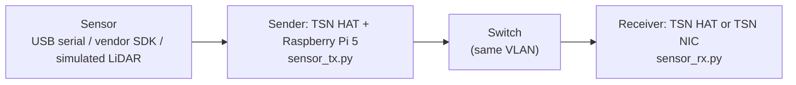

# Sending sensor data over TSN (common send/receive framework)

This example sends data read from a sensor over UDP in units (scan, frame or line) and reassembles them on the receiver.
It also measures one-way latency with the board gPTP time.

| File | Runs on | Purpose |
|---|---|---|
| `sensor_tx.py` | sender | Reads a sensor source, splits each unit into chunks, stamps the board gPTP time, sends over UDP |
| `sensor_rx.py` | receiver | Validates and reassembles chunks, counts loss per sender, measures one-way latency with hardware receive timestamps |

## 1. Setup



- Tested: TSN HAT -> TSN HAT (both directions), TSN HAT -> TSN NIC and TSN NIC -> TSN HAT, on the same switch VLAN. Sources tested: simulated LiDAR, and one line of output from an external command. The `serial:` and `file:` sources have not been tested.
- For a real LiDAR, put the device SDK calls into `read_lidar()` of `sensor_tx.py`.
- If the receiver is a TSN NIC, replace `--iface eth1` below with the interface name of that PC (for example `ens4d1`).

## 2. Data format

UDP packet = 40-byte header + data chunk (up to 1,400 bytes). A large unit is split into several chunks.

| Field | Size | Meaning |
|---|---|---|
| magic | 4 B | `TSNS` |
| version | 1 B | 3 |
| stream | 1 B | Stream ID (`--stream-id`) |
| (reserved) | 2 B | 0 |
| frame | 4 B | Unit number |
| chunk / count | 2 B + 2 B | Chunk number / number of chunks |
| seq | 4 B | Packet sequence number per stream (loss counting) |
| tx_ns | 8 B | Board gPTP time just before sending (ns) |
| total | 4 B | Total length of the unit |
| run | 8 B | Execution identifier, a random 64-bit value chosen when the sender starts |

All values are in network byte order.

The receiver reassembles a unit only from packets with the same sender IP and port, stream ID and execution identifier. Data does not mix when two senders use the same stream ID or a sender is restarted. Two executions choose the same identifier with probability 2^-64.

Packets from older senders (header versions 1 and 2) are not accepted by default (`legacy_version` in `bad_reasons`). Version 1 has no execution identifier and version 2 only 16 bits, so chunks of a previous execution may mix in when a sender is restarted on the same address. If they must be received, pass `--accept-legacy` and restart the receiver whenever the sender restarts. Using the same version on sender and receiver is recommended.

The receiver checks every chunk. Packets that fail are dropped and counted in `bad_packets` and `bad_reasons`; reception continues.

- Header version 3 (or 1 and 2 with `--accept-legacy`), chunk count >= 1, chunk number < chunk count, unit length <= `--max-frame-bytes` (default 16 MiB)
- Chunk count = unit length divided by 1,400 bytes, rounded up (1 if the length is 0). All chunks except the last are 1,400 bytes; the last chunk carries the remainder
- All chunks of a unit must have the same chunk count and unit length
- A chunk received again counts as a duplicate only if its content is identical. If the content differs, the unit is not saved
- If a chunk with different content arrives for a unit that was already complete and saved, the unit is removed from the complete count and the saved file is renamed to `<name>.invalid` (not deleted). If that name exists, `.invalid.1`, `.invalid.2` ... are used instead of overwriting. The summary `invalidated` lists the unit, reason, original file (`saved`), renamed file (`quarantined`) and error (`error`). If the rename fails, it is counted as `quarantine_failed`; the file keeps its original name but the unit is invalid. Further conflicting chunks for a unit already invalidated are counted as `conflict_after_invalidated` (the invalid unit count does not change)

| `bad_reasons` key | Meaning |
|---|---|
| `header` | Too short, or magic is not `TSNS` |
| `version` | Unsupported header version |
| `legacy_version` | Packet from an older sender (version 1 or 2) without `--accept-legacy` |
| `index` | Chunk count 0, or chunk number >= chunk count |
| `too_large` | Unit length above the limit |
| `length` | Chunk count or chunk length does not match the unit length |
| `frame_mismatch` | Same unit, but chunk count or unit length differs from earlier chunks |
| `conflict` | Same chunk received again with different content (the unit counts as `broken_frames`) |
| `conflict_after_complete` | Chunk of an already saved unit received with different content (the unit counts as `invalidated_frames`, the file becomes `.invalid`) |
| `conflict_after_invalidated` | Another conflicting chunk for a unit already invalidated (event count) |
| `not_allowed` | Sender address not listed in `--allow-from` |

## 3. Installation

Nothing to install besides Python 3.9 or later. `sensor_tx.py` imports `../common/tsnctl.py`, which is included in this repository.

```sh
cd ~/tsn-sdk/examples/sensor
```

## 4. Running

1. Receiver (in this folder). Receives for 35 s.

   ```sh
   sudo python3 sensor_rx.py --iface eth1 --port 6000 --seconds 35 --csv rx.csv
   ```

2. Sender (in this folder; `192.0.2.20` = `eth1` address of the receiver). Start within 5 s after the receiver. Sends for 30 s.

   ```sh
   sudo python3 sensor_tx.py --dest 192.0.2.20 --source sim:lidar --rate 10 --seconds 30
   ```

### Console output

Start the sender when the receiver prints its readiness line.

```text
Waiting for packets: UDP 6000, 35 s
```

The sender reports its run ID, progress, then the counts for the complete send interval. This excerpt is from a 30 s simulated LiDAR run.

```text
Sending: stream=1, run=55f3a11d2ce49615
12:52:32 frames=10 packets=20 bytes=18000
Done: frames=301, packets=602, bytes=541800
```

The receiver's final JSON includes these fields.

```json
{"packets": 602, "complete_frames": 301, "lost_packets": 0, "bad_packets": 0, "latency_us": {"min": 37.3, "median": 47.6, "p99": 65.3, "max": 94.8, "samples": 602}}
```

Check for about 301 complete frames and zero lost or bad packets. Use the run ID to compare the sender's final packet count with `streams.<key>.packets`, the unique packet count at the receiver. The top-level `packets` also counts duplicates.

Selecting the source (`--source`):

| Value | Example | Unit |
|---|---|---|
| `sim:lidar[:points]` | `sim:lidar:720` | Simulated scan (5 bytes per point), `--rate` Hz |
| `serial:<device>[:baud]` | `serial:/dev/ttyACM0:115200` | One line (LF). The USB serial device of the sensor, not the UART of the TSN board. Not tested |
| `cmd:<command>` | `cmd:python3 -u my_sensor.py` | One line of standard output. The command runs in a shell, as root when started with sudo |
| `file:<path>` | `file:scan.bin` | `--chunk` bytes, `--rate` Hz. Not tested |

To send without reading the board time, pass `--no-gptp` to the sender; `tx_ns` is then 0 and no latency is measured (`../common/tsnctl.py` must still be present).

Receiver options:

- `--out <folder>`: saves complete units as `frame_<sender IP>_<port>_<stream>_<execution id>_<number>.bin`. Existing files are not overwritten; such cases are counted as `out_exists`.
- `--allow-from <sender IP>`: accepts packets only from that address (can be given more than once).

Loss fields in the receiver summary (counted separately per sender; keys of `streams` are `<sender IP>:<port>/<stream>/<execution id>`):

| Field | Meaning |
|---|---|
| `lost_packets` | Sequence numbers between the lowest and highest received that never arrived |
| `reordered` | Packets that arrived late out of order (not losses) |
| `duplicates` | Sequence numbers received twice (not losses) |

Losses of the very first or last packets cannot be seen from the sequence range. Compare the sender packet count with `streams.<key>.packets` of that sender. The sender prints its execution identifier when it starts.

## 5. Expected results

Reference values measured by TSN Lab (through a 1 GbE switch, simulated LiDAR with 360 points at 10 Hz = 2 packets per unit, 20 packets per second). The packet count is proportional to the send time.

| Direction | Send time | Packets received | Lost | Latency samples | One-way latency (median / 99 % / max) |
|---|---|---|---|---|---|
| TSN HAT -> TSN HAT (header v3, console example above) | 30 s | 602 | 0 | 602 | 47.6 / 65.3 / 94.8 us |
| TSN HAT -> TSN HAT (header v1) | 30 s | 602 | 0 | 602 | 41.5 / 55.0 / 76.9 us |
| TSN HAT -> TSN HAT (header v1, reverse direction) | 30 s | 602 | 0 | 602 | 38.1 / 56.9 / 92.7 us |
| TSN HAT -> TSN NIC (header v1) | 20 s | 402 | 0 | - | 37.5 / 52.5 / 72.9 us |
| TSN NIC -> TSN HAT (header v1) | 10 s | 202 | 0 | - | 39.6 / 54.0 / 58.5 us |

- Earlier header v1 runs used a 32-byte header without a run ID, and the receiver grouped packets by stream ID only. Latency and packet counts can vary with the run, FPGA image, and driver.
- Latency = hardware receive time - gPTP time just before sending. It includes sender software (reading the time over PCIe, building the header, `sendto`) and the driver, board and switch path. It is not a MAC-to-MAC latency.
- Fewer latency samples than received packets mean that some packets had no hardware receive timestamp.
- Latency is only correct when both boards are synchronized by gPTP.

## 6. Troubleshooting

| Symptom | What to check |
|---|---|
| `samples` of `latency_us` is lower than the packet count | Do not run more than one receive measurement program (`sensor_rx.py`, `rtp_stats.py`, `rx_window_check.py`) on the same interface. Each program restores the hardware timestamp setting when it exits |
| Error that `/dev/xdma0_user` cannot be opened | The sender needs root to read the gPTP time. To send without time, pass `--no-gptp` |
| Latency is negative or very large | Check that `tsnctl.py sync` reports `"synced": true` on both boards |
| Nothing is sent with a `serial:` source | Check that the sensor ends lines with LF and that the baud rate is correct |
| `bad_packets` increases | Look up the keys of `bad_reasons` in the table in section 2. `header` increases if another program sends to the same UDP port. For `legacy_version`, update the sender to this version |
| `.invalid` (or `.invalid.N`) files appear | A chunk of a saved unit arrived later with different content. Check whether different data is mixed in from the same sender address and stream |
| More than one sender in `streams` | The sender was restarted, or another sender used the same port. Senders are counted separately and do not mix. To receive one sender only, pass `--allow-from` |
