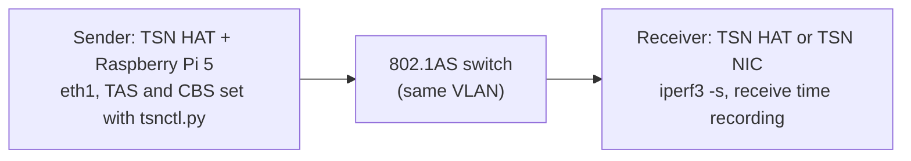

# Using TAS and CBS together

This example enables the TAS (time-aware shaper) and the CBS (credit-based shaper) of a TSN HAT on the same transmit queue, then measures the receive bandwidth and the arrival position within the TAS cycle.
All settings are made over PCIe with `tsnctl.py`. No USB cable is needed.

| File | Runs on | Purpose |
|---|---|---|
| `tas_cbs_demo.py` | sender | Pre-checks the board, then measures iperf3 bandwidth with TAS and CBS off, TAS only, CBS only and TAS + CBS, and restores the settings |
| `rx_window_check.py` | receiver | Records hardware receive timestamps and reports where in the TAS cycle the frames arrive |

## 1. Setup



- Tested: two TSN HATs (sender and receiver), and one TSN HAT (sender) with one TSN NIC (receiver), on the same 802.1AS switch VLAN.
- Both boards must be synchronized by gPTP, so the network needs a gPTP Grandmaster (see "gPTP time synchronization" in [`../README.md`](../README.md)).

Notes:

- Every frame sent by the board host (Linux) goes to hardware queue 1. Changing the VLAN PCP does not change the queue.
- gPTP uses queue 0 (FPGA image v3.3 and later, including v3.5; earlier images use queue 3). `tsnctl.py` opens queues 0 and 3 in every TAS window.
- The port names eth1 and eth2 of `tsnctl.py` are TSN ports 1 and 2 of the board. They can differ from the host interface name (eth1, ens4d1 and so on). If the receiver is a TSN NIC, replace `--iface eth1` below with the interface name of that PC.
- The default guard band is 0. With 0, a frame started just before a window closes (a 1,518-byte frame takes about 12.3 us on the wire) can extend into the closed window (TSN Lab model: a frame started up to 0.45 us before closing is still sent). To keep the closed window empty, set the guard band to at least the frame transmission time + 0.45 us, that is 13 us for 1,518-byte frames (sections 4 and 5).

## 2. Installation

On both hosts, use noninteractive installation. On Ubuntu 24.04, the iperf3 package can wait for a debconf answer over SSH.

```sh
sudo apt-get update
sudo DEBIAN_FRONTEND=noninteractive apt-get install -y iperf3 python3
cd ~/tsn-sdk/examples/tas_cbs
```

On a fresh Ubuntu 24.04 install, this accepts the default and leaves the iperf3 daemon off. Start the receiver manually as shown in Run A. An existing debconf selection is reused.

All commands below are run in this folder (`examples/tas_cbs`). The board is configured with `../common/tsnctl.py`, which is included in this repository (see [`../README.md`](../README.md)).

Check (both boards):

```sh
sudo python3 ../common/tsnctl.py info
sudo python3 ../common/tsnctl.py sync
```

- `info` must show `"se_mode": "1"`.
- `sync` must show `"synced": true` (gPTP synchronized). With older FPGA images `synced` is `null`; then check `"servo_active": true`.

## 3. Run A: bandwidth measurement

Check that both hosts can ping each other through their TSN port 1 IP
addresses. The sender needs a TCP connection to the receiver's iperf3
server to start each UDP measurement. A control connection timeout leaves
that run without a bandwidth result.

1. In terminal 1 of the receiver, start an iperf3 server. On a TSN HAT, keep it off CPU0 (see "Notes" in `../README.md`). This server is also used in run B; keep it running until the end.

   ```sh
   taskset -c 1-3 iperf3 -s     # TSN HAT (Raspberry Pi 5)
   iperf3 -s                    # TSN NIC (PC)
   ```

2. On the sender, run the example. Replace `192.0.2.20` with the `eth1` address of the receiver. It takes 1 to 2 minutes.

   ```sh
   sudo python3 tas_cbs_demo.py --server 192.0.2.20
   ```

Before writing to the board, the example checks the board with reads only. If any of the following does not hold or cannot be checked, it writes nothing, prints the reason and stops.

- The PCIe address of the board device is known (with several boards in one host, select one with `--dev` or `--iface`)
- The core registers respond and the mailbox status block (format 3 or later) is present
- The firmware ID is the value this example was checked with (`0x20261035`). The firmware ID identifies the firmware; it does not distinguish FPGA images
- The driver parameter `se_mode` is 1

If the check passes, the example prints a board check line and stores the result as `preflight` in the `--json` output.

It then reads and shows the link speed, the queue 1 guard band and the TAS status, and stops if the link is not 1 Gb/s. It then measures 10 s for each of the following settings. At the end it turns TAS and CBS off and restores the guard band to its value before the run.

This demo leaves TAS and CBS off when it ends; it does not restore a TAS or CBS configuration that existed before the run. Record the existing configuration (`sudo python3 ../common/tsnctl.py tas status`) and run the demo only when it is safe to disable TAS and CBS and restore them separately afterwards.

| Step | Setting |
|---|---|
| 1 | TAS off, CBS off (baseline) |
| 2 | TAS only: queue 1 open for the first 500 us of a 1,000 us cycle |
| 3 | CBS only: queue 1 limited to 300 Mbps (L2) |
| 4 | TAS + CBS (300 Mbps) |
| 5 | CBS only: 600 Mbps |
| 6 | TAS + CBS (600 Mbps) |

Optional arguments: `--cycle`, `--open`, `--cbs` (repeatable), `--guardband <us>` (default 0), `--time`, `--payload`, `--port-name`, `--json <file>`.

### Run A console output

The receiver's iperf3 terminal prints a `Server listening on 5201` line. The sender prints the board and gPTP checks, one result per setting, then a cleanup line. This excerpt is from a HAT-to-HAT run.

```text
Board check: /dev/xdma0_user (PCIe 0000:01:00.0), firmware ID 0x20261035, se_mode 1
gPTP synchronized: yes (slave port ['port1'], offset [115, 106] ns)
Baseline (TAS and CBS off) RX L2   986.8 Mbps  (wire   999.9)  approx. expected       -
TAS only (open 500/1000 us) RX L2   497.9 Mbps  (wire   504.4)  approx. expected   497.9 (+0.0 %)
CBS only (300 Mbps)        RX L2   299.6 Mbps  (wire   303.5)  approx. expected   300.0 (-0.1 %)
TAS+CBS(300 Mbps)          RX L2   150.9 Mbps  (wire   152.9)  approx. expected       -  model A 150.0 / model B 300.0
CBS only (600 Mbps)        RX L2   599.2 Mbps  (wire   607.1)  approx. expected   600.0 (-0.1 %)
TAS+CBS(600 Mbps)          RX L2   303.6 Mbps  (wire   307.6)  approx. expected       -  model A 300.0 / model B 497.9
Cleanup: TAS and CBS off, queue 1 guard band restored to 0 us
```

Check for `gPTP synchronized: yes` and six `RX L2` rows with the default settings. TAS alone should reduce the baseline rate. At each CBS setting, the combined TAS+CBS rate should be below CBS alone, and CBS alone should be below the baseline. The rates in the excerpt are reference measurements.

- In steps with TAS or CBS enabled, iperf3 reports a large `lost` value. It sends at line rate while the gate and CBS reduce the bandwidth of queue 1, so the excess overflows in front of the shaper (model). The value this example uses is the received L2 bandwidth. The `lost` value of the baseline step does not identify its cause (check host, board and switch counters separately).
- With TAS and CBS both enabled, `tsnctl.py cbs set --rate` is the bandwidth while the gate is open. The bandwidth over the whole cycle is rate x open ratio (300 Mbps with a 50 % open window gives about 150 Mbps). For a cycle bandwidth B, set the rate to B / open ratio (at most 1,000 Mbps).

## 4. Run B: arrival position check

1. In terminal 2 of the receiver, go to this folder and start recording. It ends after 50,000 frames or 60 s. Run step 2 within 60 s.

   ```sh
   cd ~/tsn-sdk/examples/tas_cbs
   sudo python3 rx_window_check.py --iface eth1 --cycle 1000 --open 500
   ```

2. On the sender, enable TAS and CBS and send traffic.

   ```sh
   T=../common/tsnctl.py
   sudo python3 $T tas set --cycle 1000 --window 0x02:500 --window 0x00:500
   sudo python3 $T cbs set --queue 1 --rate 300
   iperf3 -c 192.0.2.20 -u -l 1472 -b 1000M -t 15
   sudo python3 $T tas off
   sudo python3 $T cbs off --all
   ```

In `--window <mask>:<length us>`, bit n of the mask opens queue n. `0x02` = queue 1 open, `0x00` = queue 1 closed (the gPTP queues 0 and 3 are opened by the tool). Use a cycle that divides 1 s evenly (1000, 500, 250 us and so on); `rx_window_check.py` rejects other values.

To try a guard band, restart step 1 on the receiver, then run step 3 below on the sender instead of step 2. Afterwards, reset the guard band to 0 with step 4.

3. Repeat the test with a 13 us guard band.

   ```sh
   T=../common/tsnctl.py
   sudo python3 $T guardband --port eth1 --queue 1 --us 13
   sudo python3 $T tas set --cycle 1000 --window 0x02:500 --window 0x00:500
   sudo python3 $T cbs set --queue 1 --rate 300
   iperf3 -c 192.0.2.20 -u -l 1472 -b 1000M -t 15
   sudo python3 $T tas off
   sudo python3 $T cbs off --all
   ```

4. After the test, reset the guard band to 0 (it stays set after TAS and CBS are turned off).

   ```sh
   sudo python3 ../common/tsnctl.py guardband --port eth1 --queue 1 --us 0
   ```

To use a guard band in run A, run `sudo python3 tas_cbs_demo.py --server 192.0.2.20 --guardband 13`. The example restores the previous value at the end.

### Run B console output

`rx_window_check.py` prints a readiness line and, after capturing, a JSON result followed by a summary. This excerpt is from a HAT-to-HAT run with a zero guard band.

```text
Waiting for packets: eth1 UDP 5201, up to 50000 frames / 60 s
Arrival window [0, 520 us): 50000/50000 (100.00%, hardware timestamps only). Missing timestamps 0, capture drops 0, observed 4.023 s. Median first arrival per cycle 29.03 us, latest arrival 515.27 us
```

For the default test, look for 50,000 hardware timestamp samples, all inside `[0, 520)` us, and `capture_drops: 0`. The JSON reports frames without a timestamp separately as `no_timestamp`. If the script prints only the JSON and no arrival summary, check `hw_ts_samples` first.

## 5. Expected results

Reference values measured by TSN Lab through a 1 GbE 802.1AS switch, UDP payload 1,472 bytes (L2 frame 1,518 bytes), configured over PCIe, over short runs (10 to 15 s) with one frame size. The approximate expectations are model values for these conditions, not acceptance criteria.

Run A (received L2 bandwidth, Mbps):

| Setting | HAT -> HAT | HAT -> NIC | Approximate expectation |
|---|---|---|---|
| Baseline | 987.0 | 982.7 | 987.0 (line rate limit) |
| TAS only (500/1000 us) | 497.9 | 495.8 | 497.9 |
| TAS only, guard band 13 us | 485.7 | - | 485.8 |
| TAS + CBS 300 / 600, guard band 13 us | 149.8 / 299.6 | - | 150 / 300 |
| CBS only 300 | 299.6 | 298.4 | 300 |
| TAS + CBS 300 | 150.9 | 150.3 | 150 (= 300 x 0.5) |
| CBS only 600 | 599.2 | 596.6 | 600 |
| TAS + CBS 600 | 303.6 | 302.4 | 300 (= 600 x 0.5) |

- Approximate expectation (TAS only) = number of frames that can start within the window x 1,518 bytes / cycle. Number of frames = ceil((open time - guard band + 0.45 us) / 12.304 us). 0.45 us is a correction measured by TSN Lab on the board.
- With TAS and CBS together, the bandwidth is about CBS bandwidth x open ratio. The measurements match a model in which CBS credit does not accumulate while the gate is closed. The measured values differ from the approximate expectation by less than about 1.2 %.
- The HAT -> HAT values were identical over 5 runs (except one baseline run at 967.3; see section 6). A guard band of 12.3 us gave the same values as 13 us.
- With a guard band, the TAS + CBS measurements matched the values without reducing the open ratio (150 / 300). Subtracting the guard band from the open ratio (146.1 / 292.2) differs from the measurements by more than 2 %, so the guard band is not included in the TAS + CBS approximate expectation.

Run B (TAS 500/1000 us + CBS 300 Mbps, HAT -> HAT, 50,000 frames). Summary of the `rx_window_check.py` output:

| Guard band | In allowed window [0, 520 us) | No timestamp | Capture drops | Observation time | Median first arrival per cycle | Latest arrival position |
|---|---|---|---|---|---|---|
| 0 | 50000/50000 (100.00 %) | 27 | 0 | 4.023 s | 28.67 us | 514.88 us |
| 13 us | 50000/50000 (100.00 %) | 0 | 0 | 4.054 s | 22.08 us | 501.84 us |

- Only the arrival positions of frames with a hardware receive timestamp are counted (the percentage is relative to timestamped samples). Frames without a timestamp (`no_timestamp`), frames missed by the capture (`capture_drops`) and frames lost in the network are not counted. The result line reports the first two counts and the observation time.
- The arrival position is not the transmit start time. It includes the frame transmission time and the board and switch delays.
- Observation: the latest arrival position is 514.9 us with guard band 0 and 501.8 us with 13 us (502.5 us in a run with 12.3 us). In a line-rate test with TAS only (CBS off), guard band 0 / 12.3 / 13 us gave 513.95 / 497.59 / 498.55 us.
- Model: the guard band 0 value matches a model in which the last frame starts just before the window closes and is transmitted into the closed window. With a guard band, it matches a model in which that frame finishes within the window.
- Not verified: transmit start and end times on the sender were not measured. This test cannot tell which point of the frame (start or end) the receive timestamp refers to, nor resolve the 0.45 us boundary between 12.3 us and 13 us guard bands (the arrival position varies by about 1 us between runs).
- Allowed delay (`--slack`, default 20 us) = transmission of the last frame (about 12.3 us) + board and switch delay + margin.

## 6. Troubleshooting

| Symptom | What to check |
|---|---|
| Error that `/dev/xdma0_user` cannot be opened | Run with `sudo`. Check that the driver is loaded with `lsmod \| grep xdma` |
| The example reports that the board check failed and stops without configuring anything | Read the reason printed below it. If the firmware ID differs, check `fw_id` in `../common/tsnctl.py status` and use the FPGA image this example was checked with. If `se_mode` is not 1, reload the driver as described in the driver README. If the PCIe address is unknown, pass `--dev` or `--iface` |
| `No such file` (`tsnctl.py`, `rx_window_check.py`) | Check that you are in this folder (`examples/tas_cbs`) |
| Error that the sum of window lengths must equal `--cycle` | Make the window lengths add up to the cycle. The board settings are not changed in this case |
| The example reports that TAS was not applied correctly and was turned off | Check with `tsnctl.py sync` that gPTP correction is running |
| The example reports that the link is not 1 Gb/s | Check that the cable is in TSN port 1 of the board and that the switch port runs at 1 Gb/s (`tsnctl.py link`) |
| `synced` is false | Check the `eth1` link of both boards, the switch gPTP settings and that a GM exists. An empty `slave_port` means there is no synchronization peer; an `offset_ns` out of range means synchronization is still converging. Before synchronization, TAS window positions are not aligned |
| TSN HAT receive throughput is low, about 966 Mbps | Run the iperf3 server with `taskset -c 1-3`. TSN Lab observed this when the iperf3 thread ran on CPU0 together with the receive interrupt |
| The baseline value of run A is sometimes low, about 967 Mbps (L2) | Seen by TSN Lab in 1 of 4 runs with a TSN HAT receiver; the cause was not identified. The TAS and CBS values of that run were the same as in other runs |
| Transmission stops | Queue 1 was left closed. Run `sudo python3 ../common/tsnctl.py tas off` |
| The TAS-only value of run A is lower than expected | Check whether a queue 1 guard band is still set (`guardband_ticks` in `tsnctl.py tas status`). It is also shown at the start of the example |
| Some frames arrive outside the window in run B | Check for other traffic on the same VLAN. Frames interleaved at the switch egress can arrive late |
| iperf3 warning `UDP block size 1472 exceeds TCP MSS` | Can be ignored (1,472 bytes are not fragmented with MTU 1500) |
